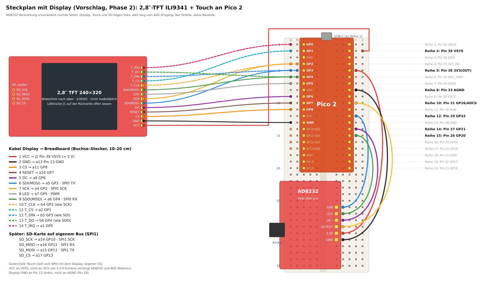

# Aufbau

## Sicherheit zuerst

| Regel | Warum |
|---|---|
| Elektroden nur am Körper, wenn das **Laptop-Ladekabel gezogen** ist | Der AD8232 hat keine galvanische Trennung. Über Netzteil und USB entsteht sonst ein Pfad vom Stromnetz zum Brustkorb. |
| Am Laptop hängt **nichts mit Netzanschluss** (Monitor/HDMI, Dock, Netzwerkkabel, USB-Hub mit Netzteil) | Jedes davon hebt die Trennung ebenfalls auf. |
| Flashen und Entwickeln mit Ladekabel nur **ohne Elektroden am Körper** | – |
| Kalibriersignal (GP15) nur **ohne Menschen** am Gerät | – |
| Desktop-PC: nur mit **USB-Isolator** (ADuM3160/4160) | Ein Desktop-PC ist immer netzbetrieben. |

Die Software warnt, wenn sie ein angeschlossenes Netzteil erkennt (`/sys/class/power_supply`), und vermerkt
das in der Aufnahme und im Bericht. Einen HDMI-Monitor oder ein Dock sieht sie aber **nicht**. Die Warnung ist
eine Erinnerung, kein Schutz.

## Steckplan

Das Pico-Board wird so gesteckt, dass der **USB-Stecker zur Reihe 1** zeigt. Die Pins sitzen dann in
**Spalte c** (Pin 1–20) und **Spalte h** (Pin 40–21) und überbrücken die Mittelrinne.
Die Stiftleiste des AD8232 kommt in **Spalte f, Reihen 26–31**. Die Platine liegt dabei über den Spalten a–e,
die Klinkenbuchse zeigt nach links.

Die Stromschienen werden **nicht** verwendet. Dein Breadboard hat in der Mitte geteilte Schienen
(Lücke in der Farblinie), und direkte Verbindungen sind ohnehin kürzer.

### Verbindungen

| Von (AD8232) | Loch | Nach (Pico) | Loch | Pin |
|---|---|---|---|---|
| SDN | g26 | GP22 | i12 | 29 |
| LO+ | g27 | GP20 | i15 | 26 |
| LO− | g28 | GP21 | i14 | 27 |
| OUTPUT | g29 | GP26 / ADC0 | i10 | 31 |
| 3.3V | g30 | 3V3(OUT) | i5 | 36 |
| GND | g31 | AGND | i8 | 33 |

### Bauteile

Keine. Es werden nur die sechs Drähte gesteckt. Das AD8232-Modul und das Pico-Board haben ihre
Abblockkondensatoren bereits auf der Platine.

Nicht nachrüsten: einen Kondensator direkt zwischen OUTPUT/GP26 und GND. Ohne Vorwiderstand kann das
den Ausgangsverstärker des AD8232 zum Schwingen bringen.

### Prüfen vor dem ersten Einschalten

- [ ] Pinbelegung des Klon-Boards auf der Unterseite mit der Tabelle vergleichen (Pin 1 = GP0 neben USB links).
- [ ] Mit dem Multimeter (Durchgang): GND des AD8232 ↔ Pin 33, 3.3V ↔ Pin 36, kein Kurzschluss zwischen 3V3 und GND.
- [ ] Nichts an VBUS (Reihe 1) oder VSYS (Reihe 2).
- [ ] Elektrodenkabel durchmessen: welche Farbe geht auf RA, LA, RL? Die Lötpads RA/LA/RL am Board sind dafür
  die Referenz. Klon-Kabel haben keine einheitlichen Farben.

### Board-Details (Klon)

- Ist das Pico-Board ein Original-Nachbau mit Schaltregler, kann GPIO23 = High (PWM-Modus) den Ripple senken.
  Das ist in der Firmware abgeschaltet (`EKG_SMPS_PWM_MODE=0`). Aktiviere es nur, wenn der Schaltplan des Boards
  das bestätigt: `cmake -DCMAKE_C_FLAGS=-DEKG_SMPS_PWM_MODE=1 …`
- Die Firmware schaltet den digitalen Eingangspuffer am ADC-Pin ab (RP2350-Erratum E9 bei Stepping A2).
- Die Board-LED blinkt im Sekundentakt, solange gemessen wird, und blitzt kurz, solange nicht gemessen wird.
  Bei Klonen kann die LED an einem anderen Pin hängen, dann bleibt sie dunkel. Auf die Messung hat das keinen Einfluss.

## Elektroden

Klebeelektroden aus Ag/AgCl mit Gel verwenden, frisch aus der Packung. Die Haut mit Alkohol abwischen und
trocknen lassen. Bei starker Behaarung die Stelle rasieren.

Die Platzierung entspricht ungefähr **Ableitung II**. Das gibt die größte R-Zacke und eine gut sichtbare
P-Welle, was für die Rhythmusbeurteilung gut ist:

| Elektrode | Position |
|---|---|
| RA | rechts unter dem Schlüsselbein |
| LA | links am unteren Rippenbogen |
| RL | rechts am unteren Rippenbogen |

Ruhig sitzen oder liegen, die Kabel nicht unter Zug. Zeigt die Software eine **negative** R-Zacke, sind RA und LA
vertauscht. Die Erkennung funktioniert trotzdem, für vergleichbare Bilder sollte man sie aber tauschen.

Meldet der Bericht **starken 50-Hz-Brumm**, zuerst prüfen, ob das Ladekabel wirklich gezogen ist und nichts mit
Netzanschluss am Laptop hängt. Danach: frische Elektroden, Haut entfetten, die Kabel nicht neben Netzkabeln oder
Mehrfachsteckdosen verlegen. Die Filter entfernen den Brumm zwar, er zeigt aber schlechten Kontakt an.
Bewegung lässt den AD8232 an den Anschlag laufen; solche Abschnitte blendet die Auswertung aus.

## Phase 2 (später): eigenständig mit Display

### Display anschließen (Vorschlag, Firmware folgt)

Das Display ist ein 2,8″-TFT mit 240×320 Pixeln („2.8 TFT SPI 240X320 V1.2“). Es hat den Controller ILI9341,
einen Touch-Controller (XPT2046, U2), einen SD-Steckplatz, einen eigenen 3,3-V-Regler (U1) und einen Transistor
für die Hintergrundbeleuchtung (Q1). Es steckt nicht im Breadboard, sondern liegt links daneben und hängt an
14 Buchse–Stecker-Kabeln (10–20 cm). Alles kommt auf die linke Seite des Pico. Der ADC-Eingang und der AD8232
liegen rechts, die AD8232-Verdrahtung bleibt unverändert.

| Display (Pin) | Loch | Pico | Zweck |
|---|---|---|---|
| 1 VCC | j2 | Pin 39 VSYS | Versorgung ≈ 5 V; der Regler U1 auf dem Display macht daraus 3,3 V |
| 2 GND | a13 | Pin 13 GND | Masse (digital, **nicht** AGND) |
| 3 CS | a11 | GP8 | Display auswählen |
| 4 RESET | a10 | GP7 | Display zurücksetzen |
| 5 DC | a9 | GP6 | Daten/Befehl |
| 6 SDI(MOSI) | a5 | GP3 | SPI0 Daten zum Display |
| 7 SCK | a4 | GP2 | SPI0 Takt |
| 8 LED | a7 | GP5 | Hintergrundbeleuchtung (schaltet nur Q1, per PWM dimmbar) |
| 9 SDO(MISO) | a6 | GP4 | SPI0 Daten vom Display (Kennung lesen) |
| 10 T_CLK | b4 | GP2 | Touch, gleiche Leitung wie SCK |
| 11 T_CS | a2 | GP1 | Touch auswählen |
| 12 T_DIN | b5 | GP3 | Touch, gleiche Leitung wie SDI |
| 13 T_DO | b6 | GP4 | Touch, gleiche Leitung wie SDO |
| 14 T_IRQ | a1 | GP0 | Berührung erkannt (low) |

Später kommt die SD-Karte auf einem eigenen Bus (SPI1) dazu. Dafür muss in die vier Lötaugen SD_SCK, SD_MISO,
SD_MOSI und SD_CS eine Stiftleiste eingelötet werden. Die Belegung ist SD_SCK → a14 (GP10), SD_MOSI → a15
(GP11), SD_MISO → a16 (GP12) und SD_CS → a17 (GP13).

| Regel | Warum |
|---|---|
| Lötbrücke **J1 offen** lassen | J1 überbrückt den 3,3-V-Regler und ist nur für 3,3 V an VCC gedacht. Mit VSYS (≈ 5 V) bekämen Display, Touch und SD-Karte 5 V. |
| VCC an **VSYS**, nicht an 3V3(OUT) | Die 3,3-V-Schiene versorgt den AD8232 und ist die ADC-Referenz. Strompulse von Display und Beleuchtung erschienen dort als Störung im EKG. |
| Display-GND an **Pin 13**, nicht an AGND (Pin 33) | Die Rückströme des Displays sollen nicht über die Analogmasse fließen. |
| Display und Kabel **links**, weg vom AD8232 und vom Elektrodenkabel | Der SPI-Takt (20–40 MHz) strahlt ab; der AD8232-Eingang ist hochohmig. |

Erster Test nach dem Anschluss: die drei Elektroden-Druckknöpfe auf ein Stück Alufolie drücken (Eingänge kurz
geschlossen) und je eine Minute mit laufendem und mit ausgeschaltetem Display aufnehmen. Das Rauschen darf sich
nicht sichtbar ändern.

### Weitere Schritte

- LiPo-Akku mit Laderegler (z. B. MCP73831) an VSYS und ein eigener rauscharmer LDO für den AD8232.
- SD-Karte (SPI) im selben Rohformat wie die Laptop-Aufnahmen.
- Die Signalverarbeitung wird nach C portiert und gegen die Python-Implementierung mit identischen
  Eingabedaten geprüft.
