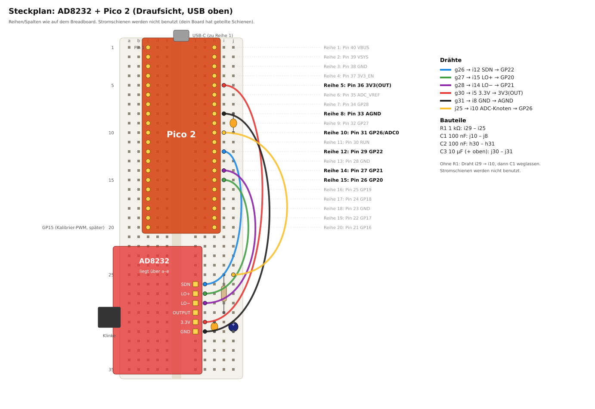
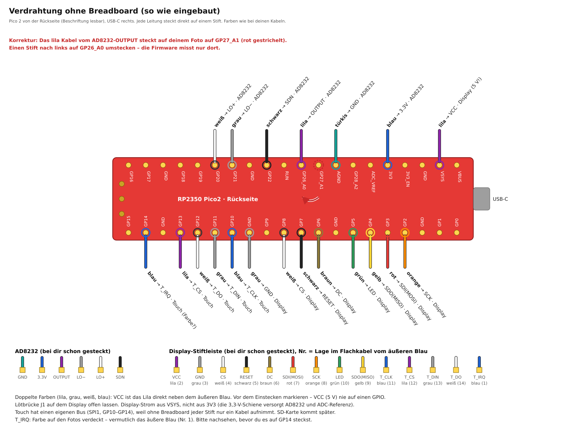

# Aufbau

Ohne Breadboard, direkt verkabelt und mit Display: siehe [Verdrahtung ohne Breadboard](#verdrahtung-ohne-breadboard-mit-display-wie-eingebaut) und [verdrahtung.svg](verdrahtung.svg).

## Sicherheit zuerst

| Regel | Warum |
|---|---|
| Elektroden nur am Körper, wenn das **Laptop-Ladekabel gezogen** ist | Der AD8232 hat keine galvanische Trennung. Über Netzteil und USB entsteht sonst ein Pfad vom Stromnetz zum Brustkorb. |
| Am Laptop hängt **nichts mit Netzanschluss** (Monitor/HDMI, Dock, Netzwerkkabel, USB-Hub mit Netzteil) | Jedes davon hebt die Trennung ebenfalls auf. |
| Flashen und Entwickeln mit Ladekabel nur **ohne Elektroden am Körper** | – |
| Kalibriersignal (GP15) nur **ohne Menschen** am Gerät | – |
| Desktop-PC: nur mit **USB-Isolator** (ADuM3160/4160) | Ein Desktop-PC ist immer netzbetrieben. |

Die Software warnt, wenn sie ein angeschlossenes Netzteil erkennt (`/sys/class/power_supply`), und vermerkt
das in der Aufnahme und im Bericht. Einen HDMI-Monitor oder ein Dock sieht sie aber **nicht**. Die Warnung ist
eine Erinnerung, kein Schutz.

## Steckplan

Das Pico-Board wird so gesteckt, dass der **USB-Stecker zur Reihe 1** zeigt. Die Pins sitzen dann in
**Spalte c** (Pin 1–20) und **Spalte h** (Pin 40–21) und überbrücken die Mittelrinne.
Die Stiftleiste des AD8232 kommt in **Spalte f, Reihen 26–31**. Die Platine liegt dabei über den Spalten a–e,
die Klinkenbuchse zeigt nach links.

Die Stromschienen werden **nicht** verwendet. Dein Breadboard hat in der Mitte geteilte Schienen
(Lücke in der Farblinie), und direkte Verbindungen sind ohnehin kürzer.

### Verbindungen

| Von (AD8232) | Loch | Nach (Pico) | Loch | Pin |
|---|---|---|---|---|
| SDN | g26 | GP22 | i12 | 29 |
| LO+ | g27 | GP20 | i15 | 26 |
| LO− | g28 | GP21 | i14 | 27 |
| OUTPUT | g29 | GP26 / ADC0 | i10 | 31 |
| 3.3V | g30 | 3V3(OUT) | i5 | 36 |
| GND | g31 | AGND | i8 | 33 |

### Bauteile

Keine. Es werden nur die sechs Drähte gesteckt. Das AD8232-Modul und das Pico-Board haben ihre
Abblockkondensatoren bereits auf der Platine.

Nicht nachrüsten: einen Kondensator direkt zwischen OUTPUT/GP26 und GND. Ohne Vorwiderstand kann das
den Ausgangsverstärker des AD8232 zum Schwingen bringen.

### Prüfen vor dem ersten Einschalten

- [ ] Pinbelegung des Klon-Boards auf der Unterseite mit der Tabelle vergleichen (Pin 1 = GP0 neben USB links).
- [ ] Mit dem Multimeter (Durchgang): GND des AD8232 ↔ Pin 33, 3.3V ↔ Pin 36, kein Kurzschluss zwischen 3V3 und GND.
- [ ] Nichts an VBUS (Reihe 1) oder VSYS (Reihe 2).
- [ ] Elektrodenkabel durchmessen: welche Farbe geht auf RA, LA, RL? Die Lötpads RA/LA/RL am Board sind dafür
  die Referenz. Klon-Kabel haben keine einheitlichen Farben.

### Board-Details (Klon)

- Ist das Pico-Board ein Original-Nachbau mit Schaltregler, kann GPIO23 = High (PWM-Modus) den Ripple senken.
  Das ist in der Firmware abgeschaltet (`EKG_SMPS_PWM_MODE=0`). Aktiviere es nur, wenn der Schaltplan des Boards
  das bestätigt: `cmake -DCMAKE_C_FLAGS=-DEKG_SMPS_PWM_MODE=1 …`
- Die Firmware schaltet den digitalen Eingangspuffer am ADC-Pin ab (RP2350-Erratum E9 bei Stepping A2).
- Die Board-LED blinkt im Sekundentakt, solange gemessen wird, und blitzt kurz, solange nicht gemessen wird.
  Bei Klonen kann die LED an einem anderen Pin hängen, dann bleibt sie dunkel. Auf die Messung hat das keinen Einfluss.

## Elektroden

Klebeelektroden aus Ag/AgCl mit Gel verwenden, frisch aus der Packung. Die Haut mit Alkohol abwischen und
trocknen lassen. Bei starker Behaarung die Stelle rasieren.

Die Platzierung entspricht ungefähr **Ableitung II**. Das gibt die größte R-Zacke und eine gut sichtbare
P-Welle, was für die Rhythmusbeurteilung gut ist:

| Elektrode | Position |
|---|---|
| RA | rechts unter dem Schlüsselbein |
| LA | links am unteren Rippenbogen |
| RL | rechts am unteren Rippenbogen |

Ruhig sitzen oder liegen, die Kabel nicht unter Zug. Zeigt die Software eine **negative** R-Zacke, sind RA und LA
vertauscht. Die Erkennung funktioniert trotzdem, für vergleichbare Bilder sollte man sie aber tauschen.

Meldet der Bericht **starken 50-Hz-Brumm**, zuerst prüfen, ob das Ladekabel wirklich gezogen ist und nichts mit
Netzanschluss am Laptop hängt. Danach: frische Elektroden, Haut entfetten, die Kabel nicht neben Netzkabeln oder
Mehrfachsteckdosen verlegen. Die Filter entfernen den Brumm zwar, er zeigt aber schlechten Kontakt an.
Bewegung lässt den AD8232 an den Anschlag laufen; solche Abschnitte blendet die Auswertung aus.

## Phase 2 (später): eigenständig mit Display

### Verdrahtung ohne Breadboard, mit Display (wie eingebaut)

Im Gehäuse steckt alles mit Buchse–Buchse-Kabeln direkt auf den Stiften. Der Pico liegt mit der
Rückseite nach oben, sodass die Beschriftung lesbar ist, USB-C zeigt nach rechts. Die AD8232-Belegung ist
dieselbe wie im Steckplan oben.

Ohne Breadboard nimmt jeder Stift nur ein Kabel auf. Deshalb hat der Touch-Controller einen eigenen Bus
(SPI1) und teilt sich die Leitungen nicht mit dem Display.

Das Display ist ein 2,8″-TFT mit 240×320 Pixeln („2.8 TFT SPI 240X320 V1.2“). Es hat den Controller ILI9341,
einen Touch-Controller (XPT2046, U2), einen SD-Steckplatz, einen eigenen 3,3-V-Regler (U1) und einen Transistor
für die Hintergrundbeleuchtung (Q1).

| Von | Farbe (dieser Aufbau) | Pico-Stift |
|---|---|---|
| AD8232 GND | türkis | AGND |
| AD8232 3.3V | blau | 3V3 |
| AD8232 OUTPUT | lila | **GP26_A0** |
| AD8232 LO− | grau | GP21 |
| AD8232 LO+ | weiß | GP20 |
| AD8232 SDN | schwarz | GP22 |
| Display VCC | lila (2) | **VSYS** (≈ 5 V) |
| Display GND | grau (3) | GND zwischen GP9 und GP10 |
| Display CS | weiß (4) | GP8 |
| Display RESET | schwarz (5) | GP7 |
| Display DC | braun (6) | GP6 |
| Display SDI(MOSI) | rot (7) | GP3 (SPI0) |
| Display SCK | orange (8) | GP2 (SPI0) |
| Display LED | grün (10) | GP5 |
| Display SDO(MISO) | gelb (9) | GP4 (SPI0) |
| Touch T_CLK | blau (11) | GP10 (SPI1) |
| Touch T_CS | lila (12) | GP13 |
| Touch T_DIN | grau (13) | GP11 (SPI1) |
| Touch T_DO | weiß (14) | GP12 (SPI1) |
| Touch T_IRQ | blau (1)? | GP14 |

Die Zahl in Klammern ist die Lage im 14-adrigen Flachkabel, vom äußeren blauen Draht gezählt. Lila, grau,
weiß und blau kommen doppelt vor. VCC ist das Lila direkt neben dem äußeren Blau; es vor dem Einstecken
markieren, denn 5 V auf einem GPIO oder an einem Display-Eingang zerstören ihn. Die Farbe von T_IRQ war auf
den Fotos verdeckt. Bei anderen Kabeln gilt nur die Spalte Pico-Stift.

Die SD-Karte kommt später dazu. Dafür muss in die vier Lötaugen SD_SCK, SD_MISO, SD_MOSI und SD_CS eine
Stiftleiste eingelötet werden; die Pins werden dann festgelegt.

| Regel | Warum |
|---|---|
| Lötbrücke **J1 offen** lassen | J1 überbrückt den 3,3-V-Regler und ist nur für 3,3 V an VCC gedacht. Mit VSYS (≈ 5 V) bekämen Display, Touch und SD-Karte 5 V. |
| VCC an **VSYS**, nicht an 3V3 | Die 3,3-V-Schiene versorgt den AD8232 und ist die ADC-Referenz. Strompulse von Display und Beleuchtung erschienen dort als Störung im EKG. |
| Display-GND an einen GND-Stift der GP-Reihe, nicht an AGND | Die Rückströme des Displays sollen nicht über die Analogmasse fließen. |
| Display-Kabel nicht neben dem lila OUTPUT-Kabel und dem Elektrodenkabel führen | Der SPI-Takt (20–40 MHz) strahlt ab; der AD8232-Eingang ist hochohmig. |

Erster Test nach dem Anschluss: die drei Elektroden-Druckknöpfe auf ein Stück Alufolie drücken (Eingänge kurz
geschlossen) und je eine Minute mit laufendem und mit ausgeschaltetem Display aufnehmen. Das Rauschen darf sich
nicht sichtbar ändern.

### Display: Bedienung

Nach dem Einschalten zeigt das Display gut 3 s den Startbildschirm „SophiEKG“, danach die laufende Kurve.
Herzfrequenz und Signalstatus rechnet der Pico selbst, mit derselben QRS-Erkennung wie der Laptop. Dafür muss
kein Laptop angeschlossen sein. Ist einer angeschlossen, laufen Aufnahme und Anzeige wie bisher parallel.

| Geste | Wirkung |
|---|---|
| kurz tippen | Helligkeit 100 % → 50 % → 20 % |
| 2 s halten | Bild um 180° drehen |

Beide Einstellungen bleiben nach dem Ausschalten erhalten. Solange das Laptop-Programm Daten empfängt,
speichert der Pico erst danach, denn das Schreiben in den Flash hält die Erfassung kurz an.

Oben rechts steht **Laptop**, solange das Laptop-Programm Daten empfängt, sonst **USB**, wenn nur das
Kabel steckt, und **TEST** beim Testsignal. Wird das Laptop-Programm geschlossen, schaltet der Pico vom
Testsignal zurück auf die Elektroden. Unten stehen Herzfrequenz, Signalstatus und das letzte RR-Intervall. Die Eichzacke
links ist 1 mV hoch, bei großer Verstärkung 0,5 mV. Die Verstärkung passt sich der R-Zacke an und wechselt
nur, wenn die Kurve am linken Rand neu beginnt.

| Bild | Ursache |
|---|---|
| weiß, es passiert nichts | CS, DC, RESET, SCK oder SDI vertauscht oder lose |
| bleibt dunkel | LED (GP5) oder VCC |
| Rot und Blau vertauscht, gespiegelt oder verzerrt | bitte melden: anderer Controller als ILI9341 |
| Tippen wirkt nicht | T_IRQ (GP14) |

`cat /dev/ttyACM1` zeigt beim Verbinden die Zeile „Display: Kennung 0x9341 (ILI9341)“. Steht dort
„liest nicht zurück“, fehlt meist nur SDO (GP4); das Bild kann trotzdem funktionieren.

### Stromversorgung ohne Laptop: Batteriebox 3×AA

Auf VSYS steckt schon das Display. Deshalb führt eine 3er-Wago drei Leitungen zusammen.

| Batteriebox | Verbindung |
|---|---|
| Plus (rot) | 3er-Wago, zusammen mit Display-VCC (lila) und einem kurzen Buchse-Kabel zu **VSYS** |
| Minus (schwarz) | 2er-Wago mit einem halbierten Buchse-Kabel zu **GND** (Pin 38, zwischen 3V3_EN und VSYS) |

- **Batteriebox ausschalten, sobald USB steckt.** Ohne Diode speist USB sonst über VSYS in die Batterien;
  Alkali-Zellen können dabei auslaufen. Mit Laptop also Box aus, ohne Laptop Box an.
- Vor dem ersten Einschalten die Polarität prüfen: Rot muss an VSYS. Verpolt zerstören −4,5 V den Pico.
- Nur normale Alkali-Batterien, alle drei gleich alt.
- Laufzeit grob 15–20 h bei voller Helligkeit: Pico und AD8232 brauchen etwa 25 mA, das Display 60–90 mA.
  Mit 20 % Helligkeit hält es deutlich länger.
- Der Pico regelt VSYS selbst auf 3,3 V (bis etwa 1,8 V hinunter), der AD8232 hängt an diesen 3,3 V. Das EKG
  bleibt deshalb sauber, bis die Batterien fast leer sind. Wird das Display dunkler oder flackert es,
  Batterien tauschen.

Batteriebetrieb ist die sicherste Art zu messen, denn dabei gibt es keine Verbindung zum Stromnetz.

### Weitere Schritte

- SD-Karte (SPI) im selben Rohformat wie die Laptop-Aufnahmen.
- Später: LiPo-Akku mit Laderegler (z. B. MCP73831) und ein eigener rauscharmer LDO für den AD8232.
